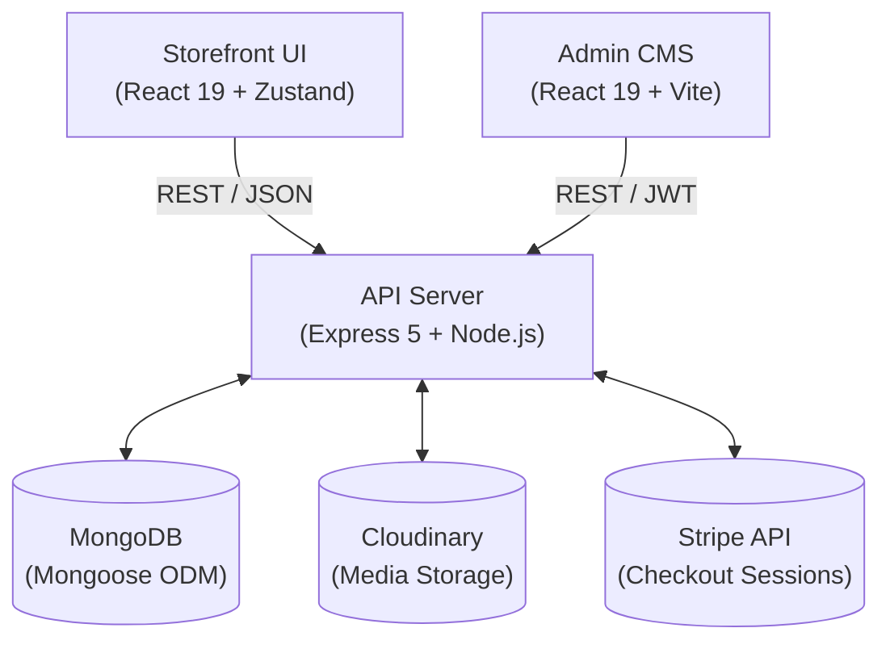

# Forever — E-Commerce Platform & CMS

[](https://react.dev/)
[](https://nodejs.org/)
[](https://expressjs.com/)
[](https://www.mongodb.com/)
[](https://zustand-demo.pmnd.rs/)
[](https://tailwindcss.com/)
[](https://stripe.com/)
[](https://vitest.dev/)

A full-stack e-commerce system featuring a customer-facing storefront, a dedicated administrative Content Management System (CMS), and a RESTful API with Stripe payments, in-memory catalog caching, and automated cloud asset lifecycle management.

---

## Live Deployments

| Service | URL |
| :--- | :--- |
| **Storefront** | [forever-frontend-xi-beryl.vercel.app](https://forever-frontend-xi-beryl.vercel.app/) |
| **Admin CMS** | [forever-admin-pi-pink.vercel.app](https://forever-admin-pi-pink.vercel.app/) |

> **Demo Credentials (Storefront & Admin CMS):**  
> **Email:** `admin@forever.com` | **Password:** `12345678`

> 📖 **Recruiter & Interview Guide:** Looking for modular resume bullet points, ATS keywords, or technical interview Q&A? See [`RESUME_AND_INTERVIEW_GUIDE.md`](./RESUME_AND_INTERVIEW_GUIDE.md).

---

## System Architecture



---

## Technical Highlights

* **In-Memory Caching & HTTP Cache Control:** The `/api/v1/products/list` endpoint leverages `node-cache` to store the catalog in RAM and returns `Cache-Control: public, max-age=60` headers, eliminating redundant database queries on repeated traffic.
* **B-Tree Indexing & Lean Queries:** Heavily queried fields (`category`, `subCategory`, `userId`, `metadata.stripeSessionId`) use explicit single-field indexes for $O(\log N)$ lookups. Read-only requests utilize Mongoose `.lean()` to bypass document hydration and minimize memory overhead.
* **Idempotent Stripe Checkout Pipeline:** Webhook/session verification utilizes atomic MongoDB upsert operations (`findOneAndUpdate` with `$setOnInsert`) on unique Stripe session IDs, ensuring transactions cannot be processed twice.
* **N+1 Query Elimination:** The order verification engine deduplicates cart product IDs and resolves them in a single MongoDB `$in` batch query paired with an in-memory `Map` lookup.
* **Automated Cloud Asset Cleanup:** Product deletion triggers automated Cloudinary asset deletion (`cloudinary.uploader.destroy`), preventing orphaned images and cloud storage leaks.
* **Predictable Global State with Test Coverage:** Cart multi-variant sizing and user sessions are managed via **Zustand**, backed by unit tests written in **Vitest**.

---

## Repository Structure

```text
E-Commerce/
├── backend/            # Express 5 REST API & database models
│   ├── config/         # MongoDB and Cloudinary configurations
│   ├── controllers/    # Route controllers (Auth, Cart, Order, Product)
│   ├── middlewares/    # JWT auth, Admin auth, Multer upload, Async handler
│   ├── models/         # Mongoose schemas (User, Product, Order)
│   ├── routes/         # Express API route modules (/api/v1/*)
│   └── scripts/        # Database seed & reset scripts
├── frontend/           # Customer storefront (React 19 + Vite + Tailwind 4)
│   ├── src/components/ # Modular UI components
│   ├── src/pages/      # Storefront pages (Collection, Cart, Orders, Checkout)
│   └── src/store/      # Zustand global state store & Vitest test suites
└── admin/              # Inventory & Order CMS dashboard (React 19 + Vite)
    ├── src/components/ # Sidebar, Navbar, Admin auth guard
    └── src/pages/      # Product creation, listing, and order management
```

---

## Tech Stack

| Domain | Technologies |
| :--- | :--- |
| **Frontend** | React 19, Vite 7, Tailwind CSS 4, Zustand 5, Axios, React Router 7 |
| **Backend** | Node.js, Express 5, Mongoose 8, Bcrypt, JSON Web Tokens (JWT) |
| **Database & Cloud** | MongoDB Atlas, Cloudinary Media SDK |
| **Payments** | Stripe Checkout Sessions API |
| **Testing & Tooling** | Vitest, JSDOM, ESLint, Nodemon, Compression |

---

## Getting Started

### Prerequisites
* [Node.js](https://nodejs.org/) (v18 or higher)
* [MongoDB](https://www.mongodb.com/) connection URI (Local or MongoDB Atlas)
* [Cloudinary](https://cloudinary.com/) & [Stripe](https://stripe.com/) developer accounts

---

### 1. Clone the Repository
```bash
git clone https://github.com/SILLY-CODEER5/E-Commerce.git
cd E-Commerce
```

---

### 2. Backend Configuration & Setup

```bash
cd backend
npm install
```

Create a `.env` file in `backend/`:
```env
PORT=4000
MONGODB_URI=your_mongodb_connection_string
JWT_SECRET=your_jwt_secret_key
ADMIN_EMAIL=admin@forever.com
ADMIN_PASSWORD=12345678
STRIPE_SECRET_KEY=your_stripe_secret_key
CLOUDINARY_NAME=your_cloudinary_cloud_name
CLOUDINARY_API_KEY=your_cloudinary_api_key
CLOUDINARY_API_SECRET_KEY=your_cloudinary_api_secret
```

*(Optional) Seed the database with sample inventory:*
```bash
node scripts/resetDB.js
```

Start the backend server:
```bash
npm run server
```

---

### 3. Frontend Setup

```bash
cd ../frontend
npm install
```

Create a `.env` file in `frontend/`:
```env
VITE_BACKEND_URL=http://localhost:4000
```

Start the storefront development server:
```bash
npm run dev
```

---

### 4. Admin CMS Setup

```bash
cd ../admin
npm install
```

Create a `.env` file in `admin/`:
```env
VITE_BACKEND_URL=http://localhost:4000
```

Start the admin development server:
```bash
npm run dev
```

---

## Running Tests

Unit tests for the client-side state machine and cart calculations are implemented with **Vitest**:

```bash
cd frontend
npx vitest run
```

---

## License

This project is licensed under the [ISC License](LICENSE).
